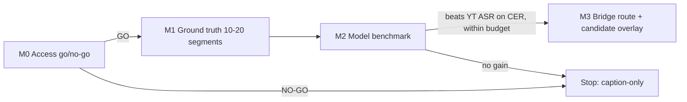

<!-- date: 2026-10-12 -->
<!-- source: chat:a4258ae7-79f7-41c8-bb81-d5396c80878f · user: audio listening model gated plan -->

# Audio Listening Model — Revised Plan (gated spike)

Worktree: `~/.gemini/antigravity/worktrees/YouTube JP Caption Studio/audio_model` · branch `feat/audio-listening-model` · base `456568178`.

## Goal Description
Add an **optional, experimental** "listen to audio" path that checks YouTube's Japanese auto-caption text against what is actually said, and offers corrections as **candidates** (provenance + Undo). It does **not** replace the sentence-enhancement MVP, and is **not** part of the MVP definition of done (parent plan §0, §9 Phase 4).

Honest baseline (verified on disk this session):
- Extension `manifest.json` permissions: `storage, cookies, sidePanel, tabs, nativeMessaging, alarms, identity`. **No `tabCapture`, no `offscreen`.**
- No Whisper/ASR dependency in `local-bridge/requirements.txt`; no `/asr` route. Only `page_capture.js` (caption interception) mentions capture.
- The sentence-MVP gates are still open: 50-segment audio gold (labels null), source17/rra05 semantic FAILs, readiness/cost KPI, Drive. This plan does not close them; it reuses their gold work.

## User Review Required
> [!IMPORTANT]
> **Capture mode decides the product claim.** `tabCapture` only hears audio *as it plays* → **delayed-subtitle mode** (correction appears after the line is spoken). Only a legitimate lookahead source (e.g. user-supplied local file) could give "ready before playback". Plan treats these as two separate modes and only claims what M0 proves.

> [!WARNING]
> Adding `tabCapture` + `offscreen` permissions changes the extension's permission prompt for users. Needs your explicit OK before M2.

> [!CAUTION]
> No DRM bypass, no downloading YouTube streams. If M0 shows audio access is not legitimately available, the spike stops (NO-GO) and the MVP stays caption-only.

## Open Questions
1. Allowed audio source for the spike: (a) `tabCapture` real-time only, (b) also a user-supplied local audio file for offline benchmarking? **Recommended: both** — (b) is the only way to benchmark CER without playback timing noise.
2. Where does the model run? **Recommended: Local Bridge (Python, MLX/whisper on Apple Silicon)**, keeping Gemini in the extension as today.
3. Acceptable compute budget on M5 Pro 24 GiB (max RAM, max RTF)? Proposed defaults: RAM ≤ 6 GiB, RTF ≤ 0.5 — unmeasured targets, to be revised after M1.
4. Do you want to hand-label the reference transcript, or should I draft candidates for you to review? (Labels must come from listening; I cannot verify audio myself.)

## Milestones & gates

### M0 — Audio access feasibility (go/no-go)
- Test, in a real Chrome profile, whether `chrome.tabCapture` (via offscreen document) yields PCM from a YouTube tab while playing; record user-gesture requirement, latency, mute-while-capturing behavior.
- Test local-file path for benchmarking (no YouTube access needed).
- Output: `review/audio-access-feasibility-<date>.md` with raw observations. Explicit statement: real-time delayed mode vs lookahead.
- **Gate:** at least one legitimate path works; otherwise NO-GO.

### M1 — Ground truth
- Reuse `testdata/sentence-mvp/parako-*-cues.json` + `parako-5-videos-manifest.json`; pick 10–20 windows focused on suspected ASR errors (names, homophone kanji, negation).
- You listen and fill reference JP text; label each error: `source_ASR_error | segmentation_error | other`.
- Store under `testdata/audio-gold/` (small text only; audio stays out of git, listed in a manifest with video ID + timestamps).
- **Gate:** ≥10 labeled windows with ≥3 confirmed `source_ASR_error`; otherwise ASR has nothing to fix → STOP.

### M2 — Model benchmark (bridge-side, offline)
- Candidates: `mlx-whisper` (large-v3-turbo), `kotoba-whisper`, `whisper.cpp`/`faster-whisper` as baseline. Add only what is installed/needed; run in `local-bridge/.venv` or an isolated venv (no global pip).
- Metrics per model: CER / normalized CER vs reference, hallucination count, RTF, peak RAM, cold-load time. Same windows, same audio.
- Compare against **YouTube auto-caption CER on the same windows** (grouping must not get credit — parent plan §8.3).
- Script: `scripts/asr_benchmark.py` → JSON + `review/asr-benchmark-<date>.md`.
- **Gate:** best model has lower CER than YouTube ASR on holdout windows, within the compute budget. Otherwise STOP.

### M3 — Integration (only after M0–M2 pass and permission approval)
- `local-bridge/app/api/asr.py`: `POST /asr/transcribe` (PCM 16 kHz mono chunks → text + segment timing); model loaded lazily, size/duration limits, 4xx on malformed input.
- Extension: offscreen doc + `tabCapture` → chunk → bridge; results stored as **candidates** in the existing sentence sidecar (`sentenceState:v1`) with `provenance: asr:<model>`, never written into script/`text_source`.
- Sidepanel: per-cue "Gợi ý nghe audio" badge with **Accept / Revert**; Accept creates an Undo revision; `mt_locked`, user-owned and deleted cues are skipped.
- Feature flag `audio_candidates_enabled` default **off**.

## Proposed Changes (files)
| Area | File | Change |
|---|---|---|
| Docs | `plan/audio-listening-model-2026-10-12.md` | [NEW] copy of this plan (repo convention §1) |
| Bench | `scripts/asr_benchmark.py` | [NEW] CER/RTF/RAM harness (M2) |
| Data | `testdata/audio-gold/*.json` | [NEW] labeled windows (M1) |
| Bridge | `local-bridge/app/api/asr.py`, `app/services/asr.py` | [NEW] M3 only |
| Bridge | `local-bridge/requirements.txt` | [MODIFY] M3 only, pinned model dep |
| Ext | `extension/manifest.json` | [MODIFY] `tabCapture`, `offscreen` — M3, needs approval |
| Ext | `extension/offscreen/*`, sidepanel/content hooks | [NEW/MODIFY] M3 |
| Wiki | `wiki/topics/audio-listening-model.md`, `wiki/index.md`, `wiki/log.md` | [NEW/MODIFY] per §4 ingest |

## Verification Plan
### Automated
- `rtk node extension/shared/sentence_groups_test.js` and existing suites stay green (no regression; ran green at `456568178`).
- Unit tests: CER function (empty, identical, kana/kanji, punctuation-normalized), asr route (valid chunk, 0-byte, oversize, wrong sample rate).
- Integration: real HTTP to `/asr/transcribe` with a fixture WAV; assert status code and parsed segments.
- Candidate application: Undo restores exact original text; locked/owned/deleted cues unchanged.
- Backend: `cd local-bridge && python -m pytest -q tests/`.

### Manual / real-browser
- M0/M3: real Chrome with extension loaded; measure overlay/sidepanel geometry before/after Accept/Revert (`getBoundingClientRect`), screenshots.
- You perform the listening labels in M1 and review model candidates.

## Explicitly not claimed
Any CER gain, RTF, RAM number, lookahead ability, or "ready before playback" — all `NOT VERIFIED` until M0–M2 produce evidence.

## Decision requested
Approve scope M0→M2 now (no manifest changes, no extension changes); M3 requires a second approval after the gate results.
