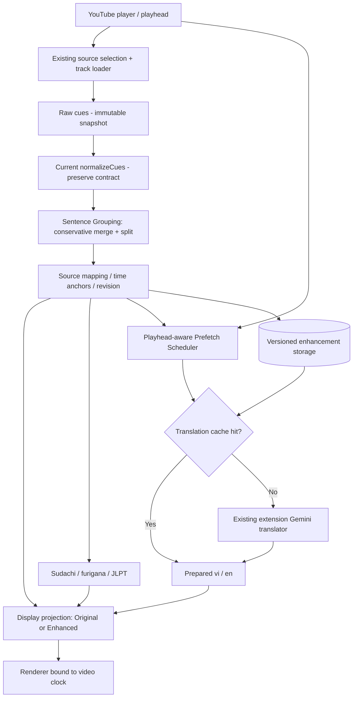

<!-- date: 2026-10-09 -->
<!-- source: chat:01a120d0-c734-73f1-8ae0-5efe130ad593 · user: Lưu, đổi tên và thực hiện plan nâng cấp phụ đề YouTube -->

# YouTube JP Caption Studio — Kế hoạch nâng cấp phụ đề YouTube (MVP ưu tiên)

> **Trạng thái:** `REVISED PLAN / READY FOR IMPLEMENTATION REVIEW` — tài liệu thiết kế, **chưa triển khai hoặc chạy benchmark**.\
> **Ngày cập nhật:** 2026-10-09.\
> **Phạm vi MVP:** YouTube trên **Chrome Extension + macOS**, tận dụng FastAPI Local Bridge và module Gemini hiện hữu; không viết lại ứng dụng.\
> **Ngôn ngữ:** phụ đề nguồn tiếng Nhật (`ja`), dịch tiếng Việt (`vi`) đang có trong module extension; bổ sung/đối chiếu khả năng dịch tiếng Anh (`en`) theo nhu cầu.\
> **Mục tiêu số 1:** **câu Nhật trọn vẹn, nội dung trung thành nguồn, và bản dịch sẵn khi lời thoại bắt đầu**, với mặc định Enhanced và có thể quay về Original.\
> **Nguồn sự thật:** thông tin mã nguồn/quan sát video trong bản review Codex do chủ dự án cung cấp; các mục chưa được kiểm chứng được đánh dấu `NOT VERIFIED`. Những đường dẫn bên dưới dùng để đối chiếu trong repo của người dùng, không ngụ ý tài liệu này đã tự chạy mã nguồn.

---

## 0. Quyết định thay đổi so với plan cũ

**Không lấy ASR streaming làm MVP.** Nếu YouTube **đã có track**, giải quyết trước các lỗi đang thấy: câu bị chia vụn qua nhiều cue; nhiều câu/lượt thoại chung một cue; dịch từng cue thiếu ngữ cảnh; bản dịch đến muộn khi video phát. **Tải track → bảo toàn cue nguồn → tạo sentence groups → chuẩn bị NLP/dịch trước playhead → render theo timeline.** ASR chỉ là nhánh thử nghiệm *xác minh/sửa nội dung*, sau khi chứng minh đọc trước audio hợp lệ và chất lượng tốt hơn nguồn.

| Vấn đề | Quyết định mới |
|---|---|
| Câu bị cắt vụn | `Sentence Grouping` là **P0**, đứng trước ASR. |
| Dịch đến sau lời nói | Dịch nhóm câu **trước vị trí phát** bằng Gemini hiện hữu. Đo tỷ lệ JP + dịch **sẵn tại thời điểm phát**, không chỉ latency sau `FINAL`. |
| Độ chính xác lời thoại | Không đồng nhất nhóm câu/dấu câu với sửa nhận diện; đánh giá ASR với ground truth trước khi tự sửa chữ Nhật. |
| Dữ liệu đã lưu | Giữ cue gốc, metadata/ownership/revision, khóa bản dịch, cue bị xóa; mọi biến đổi tự động phải hoàn tác được. |
| Gemini | **Không mặc định chuyển sang Local Bridge**: module đang ở extension, có batch, concurrency và prefetch; nâng cấp tại chỗ rồi mới xét migration riêng. |
| Phạm vi | Chrome/macOS/YouTube trước; iOS, Netflix, forced alignment, web editor mới, sync schema rộng là giai đoạn sau. |

### Ngoài phạm vi MVP

- Không hứa sub tự nghe và dịch hoàn hảo **ngay khi mở** video không có track.
- Không xây ASR streaming, source separation, diarization hoặc forced alignment trước khi có bằng chứng về lợi ích.
- Không vượt DRM, không giả định có thể tải hoặc đọc trước mọi luồng audio YouTube/Netflix.
- Không thay toàn bộ storage, tạo thêm queue Gemini song song hoặc chuyển API key qua backend trong cùng thay đổi chức năng nếu chưa có kế hoạch migration/test. Rủi ro lộ key vẫn cần được đánh giá độc lập.
- Không tự áp dụng sửa **từ ngữ** chỉ dựa trên việc Gemini/LLM thấy một cách viết hợp lý hơn.

---

## 1. Bằng chứng hiện trạng và điều chưa biết

### 1.1. Review trên code hiện tại (do Codex cung cấp)

| Thành phần | Thông tin review | File cần mở lại trước khi sửa |
|---|---|---|
| Tải và chuẩn hóa cue | Luồng tải gọi `normalizeCues()`; normalize chủ yếu loại nhãn âm thanh/giữ timing, **không nhóm câu**. Có logic ghép rolling ASR ở module khác nhưng không đi qua nhánh này. | `extension/content/content.js` quanh **373**; `extension/content/normalize_cues.js` quanh **144** |
| Chọn cue hiển thị | `findActiveCue()` theo start/end và khoảng dư **0,15 s**. Kết quả xử lý đến sau khi cue kết thúc có thể không xuất hiện đúng lúc. | `extension/content/content.js` quanh **4368** |
| Dịch Gemini | Module extension đang dịch **Nhật → Việt**, batch **15 cue**, concurrency **3**. | `extension/shared/gemini_translate.js` quanh **271** |
| Dịch trước | Có prefetch khoảng **5 cue tiếp theo**. | `extension/content/content.js` quanh **4933** |
| Serialization | Các tầng ghi dữ liệu theo tập trường cố định (`source`, `en`, `vi`, `text_source`, `mt_locked`…); trường mới dễ rơi rụng. | `extension/content/content.js` quanh **1676**; `local-bridge/app/services/script_store.py` quanh **369** |
| Ưu tiên nguồn | Code hiện có chính sách bảo vệ script người dùng, cue đã xóa và bản dịch khóa. | Kiểm tra lại toàn bộ write/read path trước khi sửa |

**Quan trọng:** Những số dòng có thể đã thay đổi theo commit/worktree. Không gán kết luận rộng hơn nội dung review; xác nhận tại commit triển khai. Những API, cấu trúc và file mới ở dưới là **đề xuất**, không được coi là code đã tồn tại.

### 1.2. Video kiểm chứng đầu tiên

- Kênh mẫu: **`@parako`**; video: **[ドライブで本音トークするやつ](https://www.youtube.com/watch?v=ylnxFdPhLCo)** (`ylnxFdPhLCo`).
- Review xác nhận player có track **Japanese auto-generated**.
- Khoảng [1:00 → 1:09](https://www.youtube.com/watch?v=ylnxFdPhLCo&t=60s): cue trước kết thúc bằng `乗せて`, cue sau bắt đầu `ないんですか?` → **một câu bị cắt giữa cue**.
- Khoảng [1:09 → 1:18](https://www.youtube.com/watch?v=ylnxFdPhLCo&t=69s): `どこ` / `行くんですか?` → **câu hỏi bị chia đôi**.
- Các đoạn khác có **nhiều câu/lượt thoại trong một cue** → không được chỉ xây bộ *merge*, phải hỗ trợ *split*.
- Đây là **quan sát transcript**, không phải xác nhận transcript đúng với âm thanh. **Lỗi nhận diện của YouTube, CER, độ cải thiện ASR: `NOT VERIFIED`.**

### 1.3. Ràng buộc phần cứng và môi trường

- Máy được Codex báo là **M5 Pro, RAM 24 GiB**. Đây không phải benchmark ASR; không chốt mô hình, tốc độ hay tiêu thụ bộ nhớ dựa trên thông số máy.
- Repo ở worktree, các đường dẫn review mang mã worktree khác nhau; trước khi sửa hãy xác định **đúng repo/branch/commit**, không chép đường dẫn tuyệt đối vào runtime.
- Chưa có bằng chứng end-to-end về xử lý audio ahead, số giây Gemini chuẩn bị trước phát, hành vi save/load/export/import/Drive khi thêm schema: tất cả **`NOT VERIFIED`**.

---

## 2. Định nghĩa sản phẩm và ưu tiên nguồn

### 2.1. Hành vi người dùng

1. Mở YouTube có track tiếng Nhật → hiện **sub nguồn ngay khi nhận được**; chạy Enhance không chặn playback.
2. Mặc định dùng **Enhanced View**: nhóm/tách theo ranh giới câu hợp lý, tra từ/furigana theo câu, dịch Việt/Anh theo **câu hoàn chỉnh**, không theo mảnh cue.
3. Khi sắp phát tới câu, **JP + bản dịch yêu cầu đã được chuẩn bị** nếu track đã tải và mạng/API đủ nhanh. Không đợi nghe câu xong mới gửi Gemini.
4. Có **Original / Enhanced** và **Undo/Restore**; xem được bản gốc và không mất chỉnh sửa cá nhân.
5. Khi chưa có bản dịch đúng revision, hiện JP ngay; **không ghép bản dịch cũ vào câu mới**, không treo renderer chờ Gemini.
6. Nếu không có track, hiển thị tình trạng giới hạn và đường fallback sẵn có. Nhánh ASR không phải điều kiện chấp nhận MVP.

### 2.2. Thứ tự ưu tiên dữ liệu

**Ưu tiên quyền sở hữu/chỉnh sửa trước thuật toán:**

1. **Script/cue do người dùng sở hữu, sửa hoặc xác nhận**, bao gồm xóa có chủ đích; bản dịch có `mt_locked`/chỉnh tay được giữ nguyên.
2. **Track nhập thủ công** nếu được chọn làm nguồn đang sử dụng.
3. **YouTube creator caption** nếu có và người dùng chọn/không có override.
4. **YouTube auto-generated caption**, là nguồn chính của Enhanced trong trường hợp mẫu.
5. **ASR/AI suggestion** chỉ được xét áp dụng theo chính sách đã kiểm chứng, **không tự ghi đè dữ liệu người dùng**.

Đây là thứ tự *bảo vệ dữ liệu + lựa chọn nguồn*, không có nghĩa creator track luôn đúng. Sử dụng lựa chọn nguồn hiện có khi đã được user đặt. Với sửa từ ASR trong tương lai, mặc định giữ provenance và có restore; tự áp dụng chỉ sau khi đạt ngưỡng đánh giá riêng, không áp dụng trên transcript user-locked.

### 2.3. Ba khái niệm không được nhập nhằng

- **Raw cue**: đối tượng nguồn có text/timestamp/track/origin riêng; không mutate để ghép câu.
- **Sentence group**: biểu diễn logic một câu với quan hệ **1–n và n–1** tới cue nguồn hoặc các đoạn text trong cue, dùng cho dịch/ngữ cảnh/tìm từ.
- **Display unit**: đối tượng UI tính từ sentence groups + trạng thái phát; có chính sách hiển thị riêng, **không lấy `group.end` để tùy tiện kéo dài qua khoảng lặng**.

**Sentence grouping không sửa ASR.** Sửa dấu câu hoặc kết hợp `乗せて` + `ないんですか` chỉ là tăng tính đầy đủ và chất lượng dịch, không chứng minh từng chữ trùng lời nói thực.

---

## 3. Pipeline MVP



### Luồng khi có track

1. Nhận `videoId`, `trackId`, locale, track fingerprint và lựa chọn nguồn; áp dụng ưu tiên user-owned.
2. Tải các cue bằng loader hiện tại. **Không trì hoãn sub Nhật thô** trong lúc tính nhóm câu.
3. Giữ `rawCues` snapshot/ID ổn định; chạy `normalizeCues()` như hiện tại, không âm thầm thay đổi contract.
4. Tạo `SentenceGroup` theo text, ngữ pháp, dấu câu, timing, khoảng im lặng, dấu hiệu đổi người nói; không đủ bằng chứng → **không merge**.
5. Kiểm tra cache đúng phiên bản; dựng furigana/từ điển và schedule nhóm câu theo playhead (ưu tiên nhóm có thể sắp đến).
6. Renderer chuyển dần sang Enhanced khi nhóm sẵn; không giật, không thay nội dung user đã chỉnh/khóa; dựa vào clock video.
7. Người dùng có thể `Switch to Original`, undo một chỉnh sửa tự động hoặc tắt Enhanced toàn video.

### Luồng khi thiếu track

Không nằm trong đường găng MVP. Giữ các phương án nhập sub / thông báo rõ. Chỉ xét ASR sau spike khả thi về audio; nếu chỉ dùng `tabCapture`, đây là **real-time có độ trễ**, không phải mô hình "sẵn sub tại thời điểm phát".

---

## 4. Sentence Grouping Engine — trọng tâm P0

### 4.1. Bài toán

Một cue có thể chứa **mảnh câu**, **nhiều câu**, hoặc **đổi người nói**. Một câu có thể kéo qua nhiều cue. Phải hỗ trợ:

- **Merge**: `乗せて` + `ないんですか？` → một nhóm logic; `どこ` + `行くんですか？` → một câu hỏi.
- **Split**: một cue chứa hai câu trọn vẹn hoặc lượt đối thoại được tách thành hai nhóm (timestamp con được đánh dấu **ước lượng** khi không có alignment).
- **Keep**: gặp im lặng dài, đổi người nói, không rõ ranh giới hoặc nhóm quá dài → giữ phân đoạn gốc.
- **Edit-safe**: bảo toàn các offset/anchor để click tra từ, highlight, sửa, lưu, khôi phục được.

### 4.2. Thiết kế mapping, không đánh mất cue gốc

Schema **minh họa đề xuất**, chưa có trong code:

```json
{
  "schemaVersion": 1,
  "videoId": "ylnxFdPhLCo",
  "trackFingerprint": "sha256:...",
  "groupId": "sg_001",
  "sourceRefs": [
    { "cueId": "cue_100", "charStart": 0, "charEnd": 3, "startMs": 60000, "endMs": 65000 },
    { "cueId": "cue_101", "charStart": 0, "charEnd": 7, "startMs": 65000, "endMs": 69000 }
  ],
  "japaneseText": "乗せてないんですか？",
  "groupStartMs": 60000,
  "groupEndMs": 69000,
  "groupingAlgorithmVersion": "sentence-v1",
  "sourceRevision": 1,
  "reviewStatus": "auto_grouped"
}
```

**Các mốc số trong JSON chỉ minh họa.** `groupStartMs`/`groupEndMs` là *envelope*, **không phải timestamp được căn chỉnh chính xác từng token**. Để split một cue, các `charStart/charEnd` nằm trong text cue nguồn; timing phần nhỏ chỉ là *estimated* trừ khi có dữ liệu alignment đáng tin cậy.

**Bất biến bắt buộc:**

- Truy ngược được mọi `group` về cue+track+revision nguồn; không làm mất text/timestamp nguồn.
- Một `sourceRef` có thể là **phần** của cue; một cue có thể đóng góp cho nhiều nhóm mà không nhân đôi ký tự ngoài ý muốn.
- Các nhóm phải bảo đảm độ phủ text thích hợp: không rơi từ, không lặp từ do split/merge; khoảng whitespace/punctuation được ghi nhận.
- ID ổn định dựa trên source fingerprint + segment refs + version; khi nhóm thay đổi, dùng revision mới và vô hiệu hóa các cache phụ thuộc.
- Cue người dùng xóa/khóa không được "sống lại" khi regroup hoặc khi client cũ lưu lại.

### 4.3. Thuật toán v1: bảo thủ, có giải thích quyết định

1. **Chuẩn hóa phục vụ phân tích**, không ghi đè cue gốc: loại noise labels theo pipeline hiện hành, chuẩn hóa khoảng trắng, đánh dấu punctuation/utterance clues.
2. **Cắt các nhóm nhiều câu trong một cue** dựa trên dấu kết thúc câu, ngữ pháp, dấu speaker có sẵn. Không tự suy timestamp chính xác của từng câu.
3. **Xem xét nối các nhóm kề nhau** khi câu trước có dấu hiệu còn dang dở, khoảng cách thời gian nhỏ, không có evidence đổi speaker và không vượt giới hạn số ký tự/thời gian.
4. **Chặn ghép** qua khoảng im lặng vượt ngưỡng, người nói khác, ranh giới video, nguồn khác, manual edits, hoặc sự không chắc chắn cao.
5. **Kiểm tra lại** cấu trúc và mapping: không có overlap bất hợp lệ, text coverage đủ, không sinh câu vô nghĩa/chèn thêm từ.
6. Trả về `groupingReason`, `warnings` và trạng thái `auto_grouped/needs_review/kept_raw` để debug; không gọi đó là "ASR confidence".

Các ngưỡng gap/độ dài câu cần **tối ưu trên tập vàng**, không chốt cứng theo ví dụ 1:00–1:09 (mốc trong review là mốc cue/transcript, không xác nhận khoảng dừng thực).

### 4.4. Lựa chọn hiển thị câu trọn vẹn

- **Full sentence view** (mặc định Enhanced): show câu đầy đủ khi group bắt đầu **nếu đã chuẩn bị từ track**; bản dịch cùng group để song song.
- **Progressive focus** (tùy chọn sau MVP): vẫn có câu đầy đủ, nhưng highlight phần theo cue source/timing; khi timing từ split là ước lượng, tránh tô chính xác từng từ một cách giả tạo.
- **Long sentence/speaker change**: nếu câu/group quá dài, tách thành display units nhỏ nhưng dịch trên *group context*; đừng ép giữ một overlay quá lâu.
- **Silence/seek/pause/rate**: renderer chọn theo source time anchors, có chính sách hold/reset cụ thể; dùng playhead làm nguồn chuẩn, không dùng timer tăng dần.
- **Click-to-dictionary/edit/save**: chuyển tọa độ click token → segment span → source cue; sửa ở lớp phù hợp và tăng revision.

**Không sửa thẳng `normalizeCues()` thành "merge all adjacent cues".** Thêm bước grouping sau normalize với các unit test độc lập.

---

## 5. Gemini dịch trước vị trí phát — tái sử dụng module hiện hữu

### 5.1. Baseline thực tế cần giữ

Theo review: `extension/shared/gemini_translate.js` dịch `ja → vi`, batch **15 cue**, concurrency **3**; `content.js` đã prefetch **5 cue tiếp theo**. Trước khi sửa, phải kiểm tra đường gọi, cache, limiter, retry, nguồn dịch và nơi áp dụng `mt_locked`. **Không tạo queue thứ hai khi queue hiện tại đủ khả năng mở rộng.**

Gemini tiếng Anh: người dùng mô tả sản phẩm có mục Việt và Anh, nhưng review chỉ **xác nhận module Gemini hiện tại dịch JP → VI**. Kiểm kê đường dịch `en`/nguồn khác trước; hỗ trợ `en` qua Gemini là **work item mới hoặc wiring cần xác minh**, không ghi như đã hoàn thành.

### 5.2. Từ cue-aware sang sentence-aware

- Đối tượng dịch chính là `SentenceGroup` ổn định (không phải mảnh `PARTIAL` của ASR).
- Dùng `groupId`, `revision`, `language`, `model`, `promptVersion`, `contextFingerprint` để phân biệt yêu cầu và kết quả.
- Với group tách từ cùng cue, dịch theo từng câu; với nhiều cue tạo một câu, dịch cả câu thay vì từng mảnh.
- Batch theo số câu/token/ngữ cảnh hợp lý; thử giữ cấu hình hiện có trước khi tối ưu. Yêu cầu Gemini trả ID nhóm, không gán kết quả theo index mù.
- Dịch Việt và Anh **theo lựa chọn hiển thị**; chỉ kết hợp cả hai đích trong một request nếu benchmark chứng minh có lợi và đường dịch `en` đã được kiểm chứng.
- Khi `mt_locked` hoặc bản dịch người dùng đã chỉnh: **skip regeneration và skip overwrite**, kể cả khi có response cũ về muộn.

### 5.3. Scheduler theo playhead (thay vì chỉ 5 cue)

**Mục tiêu:** tăng `translation_ready_at_playback_rate`, không chỉ giảm tổng thời gian dịch xong.

Ưu tiên hàng đợi:

1. Group **đang/sắp tới trong khoảng rất gần playhead** mà chưa có bản dịch hợp lệ.
2. Group trong **lookahead theo giây** (thử 20–60 giây, đo và điều chỉnh), cộng một khoảng ngữ cảnh trước câu.
3. Group sau khoảng lookahead nếu còn công suất hoặc user bật "prepare entire track".
4. Sau seek, đổi ưu tiên theo vị trí mới; đánh dấu stale/invalidate work cũ. Không được áp response nhầm `videoId`, `groupId`, `revision`.

Ví dụ (minh họa):

```text
Playhead 02:00
JP 02:00–02:10: READY     VI: READY     EN: not requested
JP 02:10–02:20: READY     VI: READY
JP 02:20–02:30: READY     VI: TRANSLATING
JP 02:30–02:40: READY     VI: QUEUED
```

- Khi có track, có thể chuẩn bị câu phía trước **không cần audio lookahead**.
- Khi video được xem lại, ưu tiên cache hợp lệ; Gemini chậm, hết quota, offline → JP vẫn hiển thị đúng thời điểm.
- Nếu response đến sau cửa sổ hiển thị, **lưu cache cho lần sau/replay** chứ không ép renderer hiển thị bản dịch cho câu đã kết thúc.
- Ưu tiên idempotency, dedupe request, debounce/priority update và giới hạn concurrency trước khi tăng số lượng request.

### 5.4. Cache theo revision/ngữ cảnh

Cache key đề xuất:

```text
videoId + trackFingerprint + groupTextHash + groupRevision
+ targetLang + model + promptVersion + contextFingerprint
```

- Khi sửa JP hoặc thay đổi mapping ảnh hưởng câu → invalidate các bản dịch/NLP phụ thuộc.
- Khi đổi style/prompt/glossary/context → invalidate phần tương ứng.
- Không tự thay bản dịch user-locked do cache của máy khác.
- Đầu ra Gemini cần JSON schema/ID validation, không diễn giải JSON bất thường thành bản dịch hợp lệ.
- Thực thi retry có backoff cho lỗi tạm thời/429, không retry vô hạn; ghi nhận latency, token, error rate và chi phí ước tính.

### 5.5. Trạng thái

**Trạng thái bền vững của nhóm câu:** `RAW → GROUPED → PREPARED`; translation có `UNREQUESTED | QUEUED | TRANSLATING | READY | ERROR | STALE | LOCKED`. `READY` phải gắn với `groupRevision` cụ thể.

**Trạng thái session phát** như `ACTIVE`, `PREFETCHING`, `IN_FLIGHT`, `PARTIAL_ASR` chỉ nằm trong runtime/session, **không lưu như dữ liệu transcript vĩnh viễn**.

---

## 6. Renderer, đồng bộ thời gian và hành vi khi trễ

`findActiveCue()` hiện chọn theo start/end và khoảng dư **0,15 s** (theo review). Với Enhanced cần projection riêng từ group sang display timeline nhưng **không phá Original mode**.

Các ca bắt buộc:

- Group spanning 2+ cues: câu hoàn chỉnh và bản dịch có thể hiển thị từ **start anchor phù hợp**; kiểm soát max duration/silence, không giữ overlay xuyên đoạn im lặng dài.
- Một cue chứa 2+ câu: xác định display boundary dựa trên punctuation/time approximations; đánh dấu timing estimate để tránh tuyên bố chính xác từng câu.
- Câu tới nhưng Gemini chưa xong: hiện **JP ngay**, dịch chờ hoặc không hiện; không kéo câu trước để che thiếu dịch.
- Gemini tới sau khi cue/group kết thúc: lưu vào cache; **không hiển thị nhảy lùi trên video đang chạy**.
- Seek, pause, playback rate 0.5–2x, tab background/resume, SPA navigation/new video ID: không hiển thị câu cũ; hủy/ignore response không còn thuộc phiên hiện tại.
- NLP/furigana được tính theo group text revision, nhưng mỗi token phải map được về source span; nhấn tra từ không bị lệch khi group merge/split.
- Fallback về Original là thao tác tức thời, không đòi hỏi tính lại Gemini hay thay đổi storage.

**Quy tắc hiển thị mặc định:** Enhanced tự động áp dụng **chỉ các biến đổi cấu trúc có đánh giá an toàn** (merge/split/punctuation hiển thị). Việc sửa **nội dung lời thoại** bằng ASR/LLM thuộc phase khác và đòi bằng chứng chất lượng riêng.

---

## 7. Storage, compatibility, revision và đồng bộ

### 7.1. Không thêm trường rồi hy vọng serializer giữ hộ

Theo review, extension và Local Bridge ghi theo whitelist có các trường như `source`, `en`, `vi`, `text_source`, `mt_locked`. Nếu nhét `sourceRefs`, `originalText`, `reviewStatus`, `revision` vào object đang lưu mà không cập nhật toàn pipeline thì metadata có thể **mất âm thầm**.

**Chiến lược MVP đề xuất:** Ưu tiên **enhancement sidecar** theo `videoId + trackFingerprint + sourceRevision` để giữ nhóm câu/cache phiên bản mà không tự thay đổi schema script người dùng hiện có. Sidecar có thể là storage local hiện hữu hoặc vùng dữ liệu versioned mới (chọn sau audit); tách với cue user-owned. Không upload sidecar lên Drive cho đến khi đường read/write của tất cả client liên quan được kiểm chứng. Nếu chọn sửa serializer chính thay sidecar, cần migration + dual-read/dual-write rõ ràng, không làm ngầm.

### 7.2. Ma trận đường đi bắt buộc xác minh

| Đường đi | Điều phải giữ | Test bắt buộc |
|---|---|---|
| Extension runtime → lưu local | cue gốc, group mapping, revisions, locks, deleted markers | Save + reload không mất field/cue |
| Extension → Local Bridge API | IDs, source ownership, sourceRefs nếu route này quản lý enhancement | JSON round-trip không bị whitelist drop |
| Local Bridge → disk | versioning, provenance, `mt_locked`, edits | Ghi disk → restart server → đọc lại |
| Disk/API → Extension reload | khôi phục Original/Enhanced mà không áp bản dịch stale | Load lại đúng overlay/locks |
| Export → import (JSON/SRT/VTT nếu áp dụng) | format hỗ trợ metadata hoặc ghi rõ format mất metadata; không xóa bản gốc | Round-trip từng format, có cảnh báo lossiness |
| Google Drive up/download | Không phá sync schema cũ; eventual sync/merge có chính sách | Upload/download lại không mất script user-owned |
| Client cũ đọc rồi ghi | Không silent-drop sidecar/field mới hoặc ghi đè bản mới | Old-client round-trip / deny incompatible write |

Đối với SRT/VTT vốn không chở đầy đủ metadata, cần **manifest/JSON companion** hoặc giới hạn rõ rằng export đó là *flat subtitle view*, không phải bản sao dữ liệu có thể edit/sync hai chiều không mất mát.

### 7.3. Chiến lược migration

1. Đọc cấu trúc/version đã tồn tại; audit mọi serializer ở extension, bridge, export/import và Drive.
2. Đặt `schemaVersion` riêng cho **enhancement data**; không sửa ngay các trường script cũ.
3. Khi đọc: support dữ liệu không có enhancement → dựng lại group từ track; giữ mọi user edits/locks.
4. Khi ghi: atomic write/version check; không overwrite bản mới bằng response/request có revision cũ.
5. Nếu client cũ không thể giữ trường mới, **không cho đường write đó mutate enhancement**; cô lập sidecar hoặc migration có feature gate.
6. Chỉ bật Drive sync cho metadata mới khi đã có test tương thích (hoặc protocol version và rollback). Sync hiện có của dữ liệu cũ vẫn phải hoạt động.

---

## 8. Đánh giá chất lượng dựa trên 5 video `@parako`

### 8.1. Tạo bộ gold set trước khi tối ưu

- Chọn **5 video** của `@parako` (bao gồm `ylnxFdPhLCo`); ghi video ID, thời lượng, loại track và phiên bản lấy được.
- Mỗi video chọn các đoạn đại diện: câu cắt ngang cue, nhiều câu trong một cue, lời nói nhanh, đổi speaker, im lặng, từ lóng/tên riêng, câu phủ định.
- Hai ví dụ **`乗せて` + `ないんですか?`** và **`どこ` + `行くんですか?`** là các test case bắt buộc.
- **Nghe lại và kiểm tra với audio/chữ trong video** để tạo transcript chuẩn; nhãn phân biệt `source_ASR_error`, `parser_error`, `segmentation_error`, `renderer_timing_error`, `translation_error`.
- Có **gold sentence boundaries**, mapping cue/span, dấu speaker (nếu đủ chắc chắn), JP reference transcript, VN/EN reference sample và dấu time alignment kiểm chứng được.
- Không kết luận Whisper tốt hơn YouTube auto-caption từ transcript review chưa đối chiếu audio.

### 8.2. Bộ chỉ số ưu tiên trải nghiệm

| KPI | Định nghĩa | Mục tiêu release đầu tiên (đề xuất; chưa đo) |
|---|---|---|
| `broken_sentence_rate` | Số câu tham chiếu bị chia không hợp lý khi hiển thị / tổng câu | **Giảm ≥ 70% so baseline** trên gold set; đo riêng từng video |
| `wrong_merge_rate` | Số merge nối sai câu/lượt nói / tổng merge | **≤ 1%** mục tiêu thử nghiệm; rủi ro cao thì thuật toán fallback `keep raw` |
| `overpacked_cue_rate` | Phần display unit nhồi nhiều câu độc lập không hợp lý | Giảm đáng kể so baseline; báo cáo absolute count |
| `JP_ready_at_playback` | % start anchors mà sub JP đúng revision đã sẵn tại lúc player tới | Mục tiêu **≥ 99%** với video có track tải thành công, sau warm-up định nghĩa trước |
| `translation_ready_at_playback` | % start anchors có bản dịch ngôn ngữ đang bật, đúng revision, **trước/onset** playback | Mục tiêu **≥ 95%** trên test network/API xác định; báo cáo cả cold start và after warm-up |
| `user_data_preservation` | Số trường/cue/user edits/locks bị mất khi round-trip | **0 mất dữ liệu** trong bộ regression |
| `enhancement_reversibility` | Nhóm tự động có thể chuyển về Original/undo đúng nội dung | **100%** theo test cases |
| `translation_quality` | Dịch đúng ý câu, đặc biệt phủ định/chủ thể/tên riêng | Không giảm so baseline; review mẫu độc lập |
| `render_seek_correctness` | Kết quả sau seek/pause/rate đúng source/playhead | Không regression, test matrix pass |

**Định nghĩa đo bắt buộc:** phân biệt `TTFV` (từ mở trang đến hiện JP), `time_to_track_loaded`, `warm-up`, `subtitle start anchor`, ngôn ngữ đích bật, mạng, quota Gemini, playbackRate, P50/P95; công bố cả failure/cold-start. Mục tiêu ≥95% bản dịch sẵn lúc phát **không phải cam kết** trước benchmark.

### 8.3. Đo độ chính xác nội dung (phục vụ Phase ASR)

- `CER` và normalized CER so với transcript **nghe-đối-chiếu**, thêm nhãn riêng phủ định, tên riêng, Kanji đồng âm.
- So sánh `source transcript`, `Enhanced grouping` và `ASR candidate` **riêng**: grouping không được nhận công lao giảm CER vì không đổi lời thoại.
- Đo số lần AI "sửa" thành văn bản hợp lý nhưng sai lời nói; ghi cả false positive và false negative.

---

## 9. Lộ trình triển khai mới và điều kiện qua phase

### Phase 0 — Audit & gold set (P0, bắt buộc)

**Công việc**

- Chốt repo/worktree/commit, đọc call graph: loader → normalize → renderer; Gemini queue/prefetch/cache; user-owned/deleted/`mt_locked`; mọi serializer.
- Lấy 5 video `@parako`, lưu snapshot cue hợp lệ, đánh dấu những đoạn hỏng, nghe đối chiếu thành gold set.
- Instrument các mốc: `trackLoaded`, `groupPrepared`, `translationQueued`, `translationReady`, `playheadAtGroupStart`, display, seek, API error.
- Benchmark baseline trên máy thực: tỷ lệ câu lỗi, wrong merge đang có (nếu có), % dịch ready at playback, latency Gemini, memory/CPU.

**Gate:** có fixture reproducible và baseline; mọi kết luận `NOT VERIFIED` được gắn ticket kiểm chứng.

### Phase 1 — Sentence grouping + Original/Enhanced (P0)

**Công việc**

- Thêm module pure-function sentence grouping **sau normalize**, không sửa source raw.
- Hỗ trợ merge/split/keep với cue span mapping, split timing approximate, diagnostics.
- Renderer projection Enhanced; toggle Original/Enhanced; undo/restore; giữ khả năng click token/câu.
- Áp dụng nguồn ưu tiên và bảo vệ script user-owned, cue xóa, locked translation.
- Thử persistence sidecar + round-trip runtime/storage sớm, không trì hoãn đến Phase 5.

**Gate:** `broken_sentence_rate` giảm, `wrong_merge_rate` dưới ngưỡng; mapping/edit/undo và regression Original pass.

### Phase 2 — Playhead-aware Gemini prefetch (P0)

**Công việc**

- Giữ module Gemini hiện hữu; adapter nhận `SentenceGroup` và trả `groupId + revision`.
- Nâng prefetch 5-cue thành scheduling theo thời gian phía trước playhead; priority theo seek/playbackRate; dedupe/cancel/ignore stale.
- Cache đúng content/context/model/revision; tôn trọng `mt_locked`; không hiển thị late result nhảy lùi.
- Kiểm kê English path; triển khai Gemini `en` riêng nếu thực tế chưa có, không phá `vi`.
- Instrument `translation_ready_at_playback`, P50/P95, request count, API cost; tune batch/concurrency dựa trên baseline 15/3.

**Gate:** % ready at playback đạt ngưỡng hoặc có phân tích nguyên nhân; không regression user edits, cache, quota, seek.

### Phase 3 — Renderer, Japanese NLP và compatibility hardening (P1)

**Công việc**

- Cải thiện furigana/JLPT/tách từ trên câu trọn vẹn bằng Sudachi hiện hữu, giữ token-to-source mapping.
- Xử lý display units quá dài và speaker change; test pause/rate/background/new video.
- Bảo đảm save/disk/reload/export/import/Drive (đường dữ liệu cũ) không mất thông tin; tích hợp metadata mới khi tất cả client tương thích.
- Bổ sung telemetry lỗi cấu trúc, user override và quy trình rollback.

**Gate:** full regression và compatibility matrix đạt; dữ liệu user không mất qua mọi đường được hỗ trợ.

### Phase 4 — Audio lookahead / ASR quality spike (P2, có thể dừng)

**Điều kiện bắt đầu:** MVP có track đạt KPI, xác định được tập đoạn **thật sự sai nội dung** và khả năng truy cập audio hợp lệ cần kiểm tra.

**Công việc**

1. Thử **có thể đọc trước audio hợp lệ hay không** theo từng site/nguồn; test quyền, cache, kỹ thuật, TOS và DRM. `tabCapture` chỉ capture audio đang phát; **không đồng nghĩa lookahead**.
2. Nếu có audio lookahead: thử một tập nhỏ các đoạn sai nội dung với ASR (Whisper large-v3/turbo, MLX-Whisper, whisper.cpp, faster-whisper, Kotoba-Whisper hoặc Gemini Transcribe nếu phù hợp), so CER, missed speech, hallucination, thời gian chuẩn bị, tài nguyên trên **M5 Pro 24 GiB**.
3. Nếu chỉ capture audio đang phát: ghi rõ **delayed subtitle mode**; không gộp nó với claim ready-before-playback.
4. Không để ASR/LLM tự ghi đè chữ Nhật trong script người dùng. Với track YouTube, dùng **candidate overlay có provenance/undo**, chỉ bật auto-apply sửa nội dung sau đánh giá precision và chính sách riêng được duyệt.

**Gate:** chỉ mở rộng khi chứng minh **chất lượng lời thoại tăng** và trải nghiệm đúng thời điểm cải thiện; không thì giữ ASR ngoài MVP.

### Phase 5 — Mở rộng nền tảng và sync nâng cao (P2/P3)

- Đánh giá iPad/iPhone WKWebView, hạn chế audio capture và khả năng đọc track; không giả định tương đương Chrome tab capture.
- Đưa **schema enhancement có version** qua Web/SwiftUI/Drive theo migration plan sau khi tương thích verified.
- Netflix/DRM xử lý riêng theo quyền truy cập hợp lệ, ưu tiên subtitle track được phép; không bypass bảo vệ.
- Web editor, forced alignment, speaker diarization và offline ASR mobile là backlog tách biệt.

---

## 10. Backlog triển khai có thứ tự

| ID | Ưu tiên | Ticket | Đầu ra kiểm chứng |
|---|---|---|---|
| `AUD-01` | P0 | Kiểm tra loader/normalize/renderer/call graph trên đúng commit | Bản đồ module + tests hiện có |
| `AUD-02` | P0 | Kiểm tra Gemini 15-cue/3 concurrency/5-cue prefetch và đường `en` | Baseline + capability matrix |
| `DATA-01` | P0 | Thu 5 video `@parako`, nghe đối chiếu lỗi theo nhãn | Gold fixtures + danh mục lỗi |
| `DATA-02` | P0 | Instrument playhead/sub/translation readiness | Log benchmark có trace ID |
| `SEG-01` | P0 | Thiết kế `SentenceGroup`/`sourceRefs` ổn định | Schema version + unit tests |
| `SEG-02` | P0 | Conservative merge/split/keep sau normalize | Vượt case `乗せて/ないんですか`, `どこ/行くんですか` |
| `SEG-03` | P0 | Mapping click/save/edit/furigana về cue nguồn | Không lệch index/không mất text |
| `UI-01` | P0 | Original/Enhanced default toggle + undo | Có thể hoàn tác 100% transform auto |
| `STORE-01` | P0 | Audit serializer/API/disk/export/import/Drive/old client | Compatibility matrix |
| `STORE-02` | P0 | Sidecar enhancement + revision invalidation | Reload/round-trip không mất data |
| `TRANS-01` | P0 | Adapter Gemini nhận sentence groups | Dịch đúng cả câu + ID group |
| `TRANS-02` | P0 | Scheduler lookahead theo giây/playhead | Nâng % dịch ready at playback |
| `TRANS-03` | P0 | Revision/cache + mt_locked + stale response guard | Không overwrite bản dịch đã khóa |
| `TRANS-04` | P1 | Kiểm kê/hoàn thiện đường JP→EN bằng Gemini | EN hoạt động nếu được bật, không regression VI |
| `RENDER-01` | P1 | Full sentence/long group/split timing policy | Không nháy/trễ/giữ sai qua im lặng |
| `NLP-01` | P1 | Furigana, JLPT và source span sau grouping | Tra từ đúng span |
| `QA-01` | P1 | Full regression 5 videos và edit/sync matrix | KPI + artifact kết quả |
| `ASR-01` | P2 | Feasibility audio-ahead hợp lệ | Go/no-go report |
| `ASR-02` | P2 | ASR model comparison trên ground truth | CER, timing, RTF, RAM, false corrections |
| `PLATFORM-01` | P3 | Cross-platform/Drive metadata rollout | Versioned sync + old-client policy |

### Mapping tới code (gợi ý vị trí, phải xác minh trước commit)

- `extension/content/normalize_cues.js`: giữ normalization hiện có; tạo **module grouping mới cạnh luồng này**, không trộn hai khái niệm.
- `extension/content/content.js`: tích hợp output grouping, renderer projection, playhead-aware scheduler, seek guards, Original/Enhanced toggle; audit serialize quanh 1676.
- `extension/shared/gemini_translate.js`: tái sử dụng caller/retry/rate limiter, thêm interface group/response verification nếu thích hợp; **không tự thay queue**.
- `local-bridge/app/services/script_store.py`: kiểm tra whitelist và chiến lược sidecar/migration; không ngầm bỏ metadata.
- `extension` tests/fixtures: test pure function, runtime and save round-trip; không giả định tên file test tồn tại.

---

## 11. Test matrix bắt buộc và Definition of Done

### 11.1. Sentence grouping

- [ ] `乗せて` + `ないんですか?` thành **một nhóm** nếu mapping/timing trong fixture xác nhận liên tục.
- [ ] `どこ` + `行くんですか?` thành **một câu hỏi** nếu không có speaker boundary.
- [ ] Một cue chứa nhiều câu → split đúng, không mất ký tự hoặc thêm nội dung.
- [ ] Đổi speaker, im lặng dài, câu không rõ ranh giới → không tự merge sai.
- [ ] Câu phủ định, filler, tên riêng, punctuation không bị tự sửa nội dung.
- [ ] Original/Enhanced toggle, undo, re-group với revision mới hoạt động.
- [ ] Token click/selection, furigana, tra từ, lưu câu/từ map đúng source span.

### 11.2. Dịch + renderer

- [ ] Track có sẵn: JP không đợi Gemini.
- [ ] Dịch cả sentence group, không dịch mảnh cue rời như `乗せて` riêng khi đã nhóm.
- [ ] Bản dịch hợp lệ **sẵn tại group start** trên test warm-cache / prefetch; thống kê tỷ lệ cold-start riêng.
- [ ] Seek xa, tua ngược, pause, tốc độ 0.5/1/1.5/2x, video mới, tab background → không hiện sai video/revision.
- [ ] Gemini chậm/429/offline → JP hiển thị, không treo, không áp response late/stale.
- [ ] `mt_locked`, user translated/edit script và deleted cue không bị ghi đè.
- [ ] `en` chỉ dùng đường được xác minh; chế độ VN hiện tại không regression.

### 11.3. Persistence và tương thích

- [ ] Extension save → reload, API → disk → restart → reload, export/import và Google Drive đường hiện có đều **không mất trường/cue/cờ khóa user**.
- [ ] Sidecar/mapping survive refresh; invalidation xảy ra khi source text/track/version thay đổi.
- [ ] Client cũ đọc rồi ghi không âm thầm phá dữ liệu mới (hoặc bị tách hẳn khỏi sidecar).
- [ ] JSON export backup đủ metadata; SRT/VTT flatten có cảnh báo rõ nếu không round-trip metadata được.
- [ ] Test import dữ liệu legacy không có group schema.

**MVP chỉ đạt DoD khi:** các test chính pass, bộ 5 video có baseline + kết quả sau thay đổi, giảm `broken_sentence_rate` mà không đánh đổi `wrong_merge_rate`, tăng `translation_ready_at_playback`, **0 mất dữ liệu**, Original/Undo hoạt động và giới hạn còn lại được ghi rõ. **Không cần ASR** để coi MVP hoàn tất.

---

## 12. Rủi ro, security và rollback

| Rủi ro | Kiểm soát và fallback |
|---|---|
| Ghép nhầm giữa 2 speaker | Group bảo thủ, reason/warnings; không chắc → giữ cue nguồn |
| Split sai timing | Đánh dấu estimated; chưa highlight word-precise; Original fallback |
| Dịch nhóm câu khác với bản user đã khóa | Ownership/`mt_locked` thắng kết quả tự động; cache key revision |
| API quá chậm/hết quota | JP chạy độc lập; ưu tiên playhead + cache + rate limit; đừng hiển thị late result sai thời gian |
| Không đạt 95% ready khi cold start | Đo tách warm/cold; có thể prefetch khi track ready, không hứa tốc độ API tuyệt đối |
| Bị rớt metadata qua serializer | Sidecar versioned + compatibility tests; không bật sync metadata mới khi chưa đủ điều kiện |
| Không giữ được text user đã xóa | Tombstone/user override có precedence; regression test |
| Lộ Gemini key trong extension | Kiểm toán key storage/distribution; **không ship secret hardcoded**. Nếu cần proxy backend, thiết kế migration riêng có auth/rate limits và chiến lược mobile |
| Có nội dung video/nhạy cảm gửi Gemini | Chỉ gửi văn bản cần dịch, giới hạn logging, minh bạch việc gửi bên thứ ba và chính sách lưu/xóa |
| Audio lookahead bị chặn | Không bypass DRM/cơ chế truy cập; dừng spike, dùng track có sẵn |
| M5 Pro vẫn không chạy ASR đủ nhanh | Benchmark trước, chỉ giữ engine nếu đáp ứng chất lượng + hiệu năng |
| Áp tự sửa nội dung sai | Không bật mặc định ASR rewrite ở MVP; provenance + revert + đánh giá riêng |

**Feature flags tối thiểu:** `enhanced_subtitles_enabled`, `sentence_grouping_enabled`, `sentence_translation_prefetch_enabled`; flag riêng cho experimental ASR. Khi gặp regression, tắt Enhance về Original **mà không chỉnh raw source/user edits**.

---

## 13. Quyết định còn mở (phải dựa trên đo lường)

1. **Renderer của câu dài:** full sentence từ group start hay chia display units kèm context dịch? Chọn sau test người dùng; không khẳng định timing split chính xác nếu chưa align.
2. **Độ dài lookahead:** 20/30/60 giây hay adaptive theo playbackRate, mạng, queue? Chọn bằng `% ready at playback`, cost và tài nguyên.
3. **Storage sidecar ở đâu:** extension local storage hay Bridge? Chọn theo đường read/write/backup và yêu cầu offline; không làm mơ hồ quyền sở hữu dữ liệu.
4. **English Gemini hiện tại:** `en` được tạo bởi nguồn nào, được chọn ở UI như thế nào, có khóa/edit riêng chưa? Audit trước khi thêm mới.
5. **Ngưỡng auto merge và auto-split:** tune theo 5-video gold set, ưu tiên precision hơn recall.
6. **ASR audio lookahead:** có được phép/khả thi với từng nguồn không? Nếu không, trì hoãn ASR cho chế độ khác và cập nhật kỳ vọng.
7. **Migration sync đa nền tảng:** xác nhận old-client write semantics trước khi bật metadata mới trên Drive.

---

## 14. Tài liệu/đường dẫn tham chiếu

**Trong repo (theo review Codex của người dùng):**

- `extension/content/content.js` — load cues (~373), serializer (~1676), `findActiveCue` (~4368), Gemini prefetch (~4933).
- `extension/content/normalize_cues.js` — `normalizeCues` (~144).
- `extension/shared/gemini_translate.js` — Gemini batch/translation (~271).
- `local-bridge/app/services/script_store.py` — persisted script fields (~369).
- Video mẫu: https://www.youtube.com/watch?v=ylnxFdPhLCo
- Tài liệu Chrome `tabCapture`: https://developer.chrome.com/docs/extensions/reference/api/tabCapture — capture audio **đang phát**, không tự cung cấp audio phía trước playhead; user activation và quyền truy cập cần kiểm tra.

**Không phải kết quả đã được chứng minh:** ASR có cải thiện CER; audio read-ahead; tốc độ Whisper/Kotoba/Gemini trên M5 Pro; Gemini EN qua module extension; KPI latency/ready đạt đích. Mọi tuyên bố sản phẩm về các mục này chỉ được viết sau benchmark.

---

## 15. Tóm tắt thi hành cho Codex

> **MVP cần làm:** Trên YouTube đã có track Nhật, giữ cue gốc bất biến; tạo lớp sentence groups có mapping cue/span và nguồn/revision; Enhanced mặc định + Original/Undo; sử dụng Gemini translation hiện ở extension để dịch **cả câu** và **prefetch trước vị trí phát** (ưu tiên theo playhead); bảo vệ mọi chỉnh sửa, cue đã xóa, `mt_locked`; đo lỗi câu, merge nhầm, JP/dịch sẵn tại playback và thử trọn đường persistence. **Không xây ASR streaming trước.**
>
> **Thứ tự:** Audit + 5 video gold set → grouping/undo/storage-safe → Gemini playhead-aware → renderer/NLP/compatibility → audio lookahead + ASR spike có go/no-go → mở rộng platform/sync.
>
> **Nguyên tắc:** Đừng thay normalize bằng nối cue hàng loạt; đừng di chuyển Gemini sang FastAPI mà không có migration; đừng đổi schema mà bỏ quên các serializer; đừng tuyên bố sửa transcript chính xác hơn khi mới chỉ sửa segmentation.
